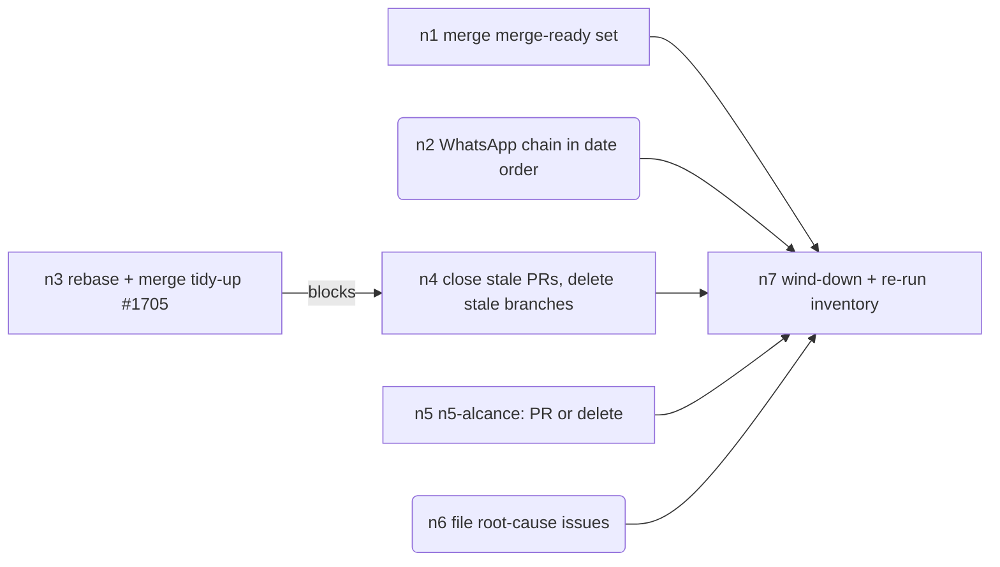

<!-- agent-generated:sesion runtime=claude-code branch=claude/project-thread-3d2z5i -->

# Branch and PR cleanup — 2026-11-23

**Status:** proposal. Nothing has been closed or deleted. Answering the decisions below and merging this PR approves the plan; execution then runs node by node.

## Decisions (frontier)

Legend: `CLN` = cleanup.

- **CLN-1 — Merge the 9 merge-ready instance PRs?** Recommended: **yes**, all except #1695 until CLN-2 is answered.
- **CLN-2 — Is the "possible same profile" link in #1695 correct?** Owner fact, cannot be verified from the repo. Recommended: **merge only if you recognise both profiles as the same person; otherwise close.**
- **CLN-3 — How to unjam the WhatsApp chain (17 PRs)?** Options: (1) merge in date order, resolving `state.md` to the newer side each time; (2) close all and run one catch-up review. Recommended: **1**, because each PR carries its own review and summary files that a catch-up run would not recreate.
- **CLN-4 — `routines/n5-alcance` (18 commits, one plan doc, no PR)?** Options: (1) open a PR; (2) delete. Recommended: **1**, it is the only unmerged branch with authored work, and a PR lets you read it before deciding.
- **CLN-5 — Close the 7 stale open PRs and delete all branches classified Stale?** Recommended: **yes**. Every deleted tip stays reachable through its PR ref (`refs/pull/<n>/head`), except the 6 branches without a PR; those are all routine runs whose content is superseded.
- **CLN-6 — File the root-cause fixes (below) as issues for the routines?** Recommended: **yes**.

```text
CLN-1 ❓ merge the merge-ready set
├─ CLN-2 ❓ #1695 same-person link
CLN-3 ❓ WhatsApp chain approach
CLN-4 ❓ n5-alcance branch
CLN-5 ❓ close stale PRs + delete stale branches
CLN-6 ❓ root-cause issues
```

```text
CLN-1: yes (without #1695)
CLN-2: <yes/no>
CLN-3: option 1
CLN-4: option 1
CLN-5: yes
CLN-6: yes
```

## Graph



## Nodes

| id | mode | status | note | session | harness | branch | pr |
|----|------|--------|------|---------|---------|--------|----|
| n1 | in_session | pending | after CLN-1, CLN-2 | | | | |
| n2 | autonomous | pending | after CLN-3 | | | | |
| n3 | in_session | pending | before n4 so tidy-up reports are not lost | | | | |
| n4 | in_session | pending | after CLN-5; commands at the end of this file | | | | |
| n5 | in_session | pending | after CLN-4 | | | | |
| n6 | autonomous | pending | after CLN-6 | | | | |
| n7 | in_session | pending | re-run the inventory; expect 0 stale | | | | |

## Log

| timestamp | node | session | event |
|-----------|------|---------|-------|
| 2026-11-23T07:30Z | — | project-thread | inventory taken, plan proposed |

## Inventory

**Scope:** every open PR and every remote branch not merged into `main` in the instance repo (`cowork-secretary`) and in this repo (`secretary-core`), as of 2026-11-23.

**How it was measured:** full (unshallowed) clone; "unmerged" = `git branch -r --no-merged origin/main`; conflicts = `git merge-tree --write-tree origin/main <branch>`; PR state = matching the branch tip against `refs/pull/*/head`. CI was spot-checked on 5 open PRs (#1768, #1766, #1745, #1558, #1377): all green. Instance branches are listed by family and PR number only, because this repo is public.

### Summary

| Repo | Open PRs | Unmerged branches | Merge-ready | Needs work | Stale |
|---|---|---|---|---|---|
| `secretary-core` | 0 | 4 | 0 | 0 | 4 |
| `cowork-secretary` | 34 | 85 | 9 | 18 | 57 (+1 to decide) |

Root causes worth fixing, beyond the one-off cleanup:

1. **Closed PRs leave their branch behind.** 45 instance branches belong to PRs that were closed without merging. Auto-delete only fires on merge.
2. **The WhatsApp review chain jams.** Each daily review edits `extractors/whatsapp/state.md`, so once one merges every other open one conflicts. Nothing from that family has merged since #1716 (2026-11-16); 17 PRs are queued.
3. **Weekly tidy-up PRs are never merged.** The last one merged was #572 (2026-07-16). The newer ones conflict on `subsystem/housekeeping/memory/recurrence.yaml`.
4. **Dream wiki-link PRs are not picked up by the auto-merge.** Six one-line PRs (#1687 to #1745) are clean and green but have been waiting up to 10 days.

### `secretary-core`

| Branch | Last commit | PR | What it was for | Class | Proposal |
|---|---|---|---|---|---|
| `core/conductor-v0` | 2026-11-10 | #108 closed | Conductor skill v0 | Stale | Delete. Superseded by #112 (`skills/conductor-v0`, merged). |
| `core/multi-harness-context-cli` | 2026-08-23 | #37 merged, #40 closed | Multi-harness context + `--max` | Stale | Delete. Both features are on `main` (`secretary/context.py`). |
| `feat/portal-aggregate-cli` | 2026-07-17 | #16 merged, #29 closed | Template anonymization + `export-examples` | Stale | Delete. `export-examples` was retired on purpose (plan `cierre-integrable`, D8b). |
| `secd/daemon-mvp` | 2026-07-02 | #6 closed | First `secd` daemon | Stale | Delete. `secd/` landed on `main` through later PRs (#20, #21, #51). |

### `cowork-secretary`

#### Merge-ready (9): clean against `main`, CI green

| PR | Branch family | Last commit | What it is |
|---|---|---|---|
| #1768 | `wiki/auto-*` | 2026-11-22 | Latest nightly wiki run, 0 commits behind `main`. |
| #1687, #1695, #1710, #1723, #1726, #1745 | `dream/memoria-wiki-*` | 2026-11-13 → 11-20 | One-line wikilink additions between related articles. All six merge together cleanly. **#1695 links two profiles as "possibly the same person": confirm that before merging.** |
| #1558 | `dream/memoria-lessons-*` | 2026-10-27 | Marks three `lessons.md` rules as superseded. |
| #1377 | `docs/registro-reversion-*` | 2026-10-02 | Reversion record and annexes for the 2026-10-01 autonomous-send incident (3 new docs). |

All 9 also merge cleanly one after another (simulated in a scratch worktree).

#### Needs work (18)

| PR(s) | Branch family | Last commit | Problem | Proposal |
|---|---|---|---|---|
| #1609, #1619, #1625, #1630, #1639, #1651, #1659, #1666, #1674, #1683, #1699, #1725, #1734, #1742, #1752, #1759, #1766 (17) | `whatsapp/review-*`, `whatsapp/auto-*` | 2026-11-02 → 11-22 | Each one is clean alone, but all edit `extractors/whatsapp/state.md`; #1683 and #1699 already conflict. | Merge in date order, resolving `state.md` to the newer side each time; or close them and run one catch-up review. Then fix the routine so it rebases before opening its PR. |
| #1705 | `subsystem/housekeeping/tidy-up-*` | 2026-11-15 | Conflict on `recurrence.yaml`. | Rebase on `main` and merge as the latest weekly tidy-up. |

#### Stale (57)

**Open PRs to close (7):**

| PR(s) | Branch | Last commit | Why stale |
|---|---|---|---|
| #1340, #1424, #1483, #1542, #1597, #1649 | `subsystem/housekeeping/tidy-up-*` | 2026-09-27 → 11-08 | Weekly reports superseded by #1705. Three of them also conflict on `recurrence.yaml`. |
| #1259 | `worktree-agent-*` | 2026-09-16 | Old daily housekeeping run from a harness worktree; daily housekeeping has merged every day since. |

**Branches whose PR is already closed (45), delete only:**

| Family | Count | PRs | Last commit range |
|---|---|---|---|
| `housekeeping/auto-*` | 10 | #725, #743, #747, #937, #954, #955, #964, #983, #997, #998 | 2026-07-23 → 08-18 |
| `dream/*` (job reports, backlog mining, contract freshness) | 10 | #754, #973, #1079, #1271, #1280, #1288, #1302, #1317, #1332, #1343 | 2026-07-25 → 09-28 |
| `reuniones/auto-*` | 7 | #336, #339, #373, #380, #890, #944, #1072 | 2026-06-24 → 08-24 |
| `wiki/*` | 5 | #318, #893, #916, #950, #1064 | 2026-06-22 → 08-24 |
| `drive/auto-*` | 3 | #319, #344, #933 | 2026-06-23 → 08-14 |
| `correo/auto-*` | 2 | #947, #1019 | 2026-08-14 → 08-19 |
| `routines/*` | 2 | #468, #715 | 2026-07-03 → 07-22 |
| `sales/*` | 2 | #1180, #1496 | 2026-09-08 → 10-20 |
| `feat/dream-collect-dynamic-repos` | 1 | #1077 | 2026-08-25 |
| `job-search/auto-*` | 1 | #1011 | 2026-08-19 |
| `portal/timeline-lane-separators` | 1 | #532 | 2026-07-09 (no diff left vs `main`) |
| `wind-down/rescue-wiki-main-dirty-*` | 1 | #1060 | 2026-08-23 |

**Branches with no PR (6):**

| Branch | Last commit | What it was for | Class | Proposal |
|---|---|---|---|---|
| `routines/n5-alcance` | 2026-10-23 | 18 commits building one plan doc (`_diseño/plans/d15-n5-scripts-sin-llm.md`, 180 lines). Merges cleanly. | **Decide** | Open a PR if the plan is still wanted; otherwise delete. The only unmerged branch with real authored work. |
| `drive/auto-20260820-1601` | 2026-08-21 | Local conflict-resolution branch | Stale | Delete. No diff left vs `main`. |
| `correo/auto-20260708-1800` | 2026-07-08 | Mail run | Stale | Delete. |
| `reuniones/auto-20260703-1900`, `reuniones/auto-20260705-1900` | 2026-07-03, 07-05 | Meeting runs (`_procesados.jsonl` only) | Stale | Delete. |
| `sales/auto-20260928-1502` | 2026-09-28 | Outbound run editing `pipeline.md`/`state.md` | Stale | Delete. Those files are now generated from the CRM. |

### Cleanup commands (not run)

```bash
# secretary-core
git push origin --delete core/conductor-v0 core/multi-harness-context-cli \
  feat/portal-aggregate-cli secd/daemon-mvp

# cowork-secretary: close the 7 stale open PRs first, then delete
# every branch listed as Stale above (gh pr close <n> --delete-branch
# for open PRs; git push origin --delete <branch> for the rest).
```

Suggested follow-ups for the system itself: have housekeeping flag branches whose PR closed unmerged, and have the WhatsApp and tidy-up routines rebase on `main` before opening a PR.
