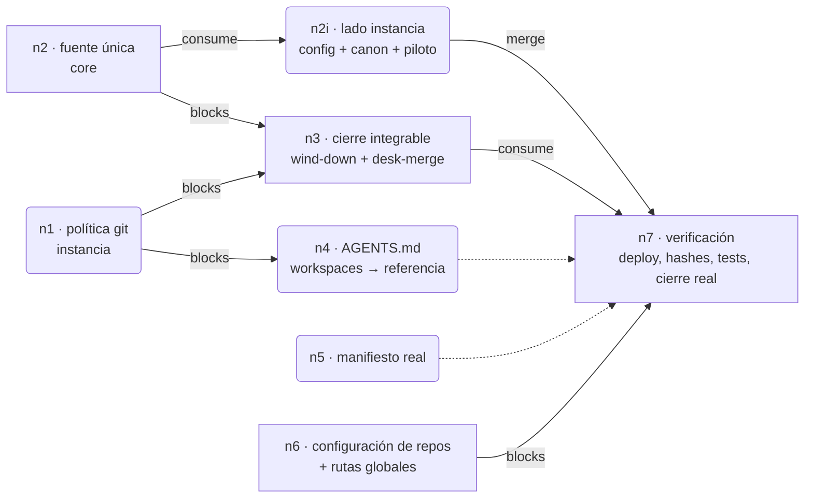
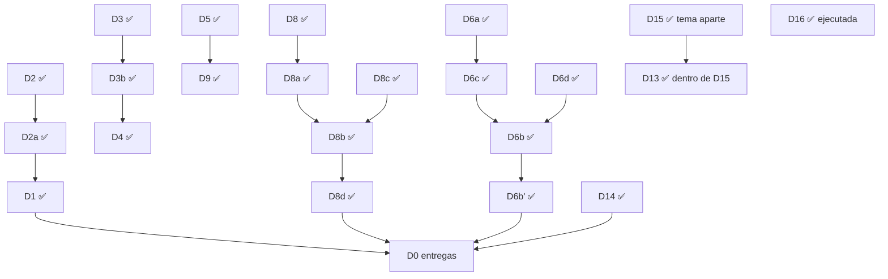

<!-- agent-generated:sesion runtime=claude-code branch=core/fuente-unica-skills -->

# Cierre integrable y fuente única de skills

**Estado:** alcance confirmado por el owner el 2026-10-23. La ejecución requiere elegir el grafo de trabajo; nada se ha implementado.

**Objetivo:** que el cierre de trabajo en git deje cada tema listo para integrar, avise de trabajo relacionado y de lo que el cambio arrastra; y que skills y playbooks tengan una sola fuente sin datos personales, con la configuración de la instancia en `.secretary`.

## Decisiones

| ID | Decisión | Estado |
|---|---|---|
| D2 | El cierre termina en "listo para integrar": commit, push, PR no draft, mergeable clean, CI verde o sin checks obligatorios, comentarios resueltos. | ✅ |
| D2a | Wind-down propone merge solo si el cambio es claro (prosa, o código con pruebas que pasan en el head) o comprobable (guía de 1–3 pasos, < 2 min). Si no, dice qué falta. | ✅ |
| D1 | desk-merge es el único ejecutor de merge. Wind-down lo invoca con confirmación. Usa merge commit, actualiza `main` local por fast-forward y no borra la carpeta. Deja de estar apagado en Dev cuando lo invoca wind-down. Sin modo nuevo. | ✅ |
| D3 | Merge commit; squash y rebase desactivados. | ✅ |
| D3b | Configuración aplicada a todos los repos no archivados del owner (merge commit sí, squash no, rebase no, borrado automático de rama remota sí), por script con `gh api` y OK explícito al ejecutar. Wind-down verifica la configuración antes de proponer merge. | ✅ |
| D4 | Se borra la rama remota al mergear (automático en GitHub). Rama local y carpeta se conservan; su limpieza va en un tema aparte con `git merge-base --is-ancestor`. | ✅ |
| D5 | Barrido de trabajo relacionado: solo lectura sobre worktrees, PRs e issues abiertos del mismo repo, por archivos tocados y scope. Avisa, no actúa. | ✅ |
| D6 | Un tema por worktree, rama desde `origin/main`, `main` limpio en el checkout principal. | ✅ |
| D6a | Mecánica en core. Política en la instancia (`canon/rules/git/`): convenciones, clases de repo, worktrees, integración, método de merge. Los AGENTS.md y globales solo la referencian. Se corrigen las contradicciones detectadas (barrido de worktrees ajenos, `skills.example`, poda en wind-down, prefijos `feat/*`, rutas `rules/` obsoletas). | ✅ |
| D6b | Wind-down corrige solo (mover carpeta, renombrar rama `claude/*`/`codex/*` a `<scope>/*`, devolver el checkout principal a `main`) y reporta. Se detiene solo si otra sesión usa la carpeta, hay cambios ajenos sin commitear o el destino existe. | ✅ |
| D6b' | Worktrees que maneja un harness (Claude Code, Codex, Cursor): commit y push, `git switch --detach` en esa carpeta, crear `.wt/<rama-slug>` sobre la rama. No se mueven. | ✅ |
| D6c | Aplica a Dev y Cowork gestión. La instancia conserva commit directo a `main`; el cierre exige que quede limpio y empujado. | ✅ |
| D6d | Lugar fijo: `<repo>/.wt/<rama con / → ->`; `.wt/` en el gitignore global. Ubicación de worktrees de Claude Code: la cambia el owner en Settings. Codex y Cursor no la permiten configurar. | ✅ |
| D7 | Limpieza de worktrees existentes: tema aparte. Excepción ejecutada a pedido: se borraron 3 carpetas (2 worktrees de PRs mergeados y 1 vacía) y se podaron 11 registros huérfanos. | ✅ |
| D8 | Fuente única de skills y playbooks en git, sin datos personales. | ✅ |
| D8a | Valores de instancia leídos en ejecución con `secretary config`. Claves nuevas: carpeta de transcripciones de reuniones y montaje de Drive. Copia instalada idéntica a la fuente. | ✅ |
| D8b | `skills.example/` y `playbooks.example/` pasan a `skills/` y `playbooks/` versionados; salen del `.gitignore`; se retira `export-examples`; el leak-guard de CI se queda. Skills y playbooks propios de la instancia viven en `canon/skills/` y `canon/playbooks/`. Nombre repetido entre core e instancia es error. | ✅ |
| D8c | Base de la reconciliación: contenido de `.example` (más nuevo). Los 7 archivos con valores personales pasan a leer config. Las copias privadas quedan fuera de git como respaldo hasta verificación del owner. | ✅ |
| D8d | Las 3 rutinas de `canon/playbooks/routines-piloto/` (las que corren hoy) pasan a core como playbook, sin datos personales; `routines-piloto` desaparece. Contenido propio de la instancia queda en canon con otro nombre. | ✅ |
| D10 | Absorbe el issue #73 (copias divergentes instaladas). El epic #19 queda como referencia. | ✅ |
| D11 | Este registro vive en `docs/plans/cierre-integrable.md` del worktree `.wt/core-fuente-unica-skills`. | ✅ |
| D12' | Fuera de alcance: whatsapp-monitor, reuniones-scheduler, playbooks de ventas y de clientes fuera de core. | ✅ |
| D13 | Activar brief-update: sale de este alcance y se decide dentro de D15, con datos de consumo. | ✅ descartada aquí |
| D14 | El manifiesto de rutinas refleja la realidad (ejecutor `claude-scheduled`, estado, fuente y horario por rutina), contrastado con el listado de tareas programadas. | ✅ |
| D15 | Auditoría de cadencia y consumo de tokens de las rutinas: tema aparte, sesión propia, hilo `routines`. | ✅ fuera de alcance |
| D16 | Rutina de buzón del cliente desactivada: `launchctl bootout` y plist renombrado a `.disabled` (reversible). Playbook del cliente intacto. | ✅ ejecutada |

## Entregas (D0)

1. Repo de instancia, rama `rules/politica-git`: `canon/rules/git/` y corrección de las instrucciones globales canónicas.
2. `secretary-core`, rama `core/fuente-unica-skills`: estructura, export, deploy, CI, claves de config, playbooks piloto.
3. `secretary-core`, rama `skills/cierre-integrable`: wind-down, desk-merge y docs.
4. Repo de mapa de workspaces: su AGENTS.md referencia la política.
5. Repo de instancia, rama `routines/manifiesto-real`: D14.
6. Fuera de PR: script de configuración de repos (D3b), corrección de rutas en instrucciones globales no versionadas, ubicación de worktrees en Claude Code (owner).

## Grafo de ejecución

Elegido por el owner el 2026-10-23 (opción 1). Los merges no son nodos: pasan por wind-down y desk-merge con confirmación (D1).

| id | mode | status | note |
|----|------|--------|------|
| n1 | autonomous | done | PR en la instancia `rules/politica-git`: `canon/rules/git/` y corrección de las instrucciones globales canónicas |
| n2 | in_session | done | PR alvaroemur/secretary-core#77 (CI verde, mergeable) |
| n2i | autonomous | done | PR en la instancia: claves de config, `canon/skills/`, retiro de `routines-piloto` |
| n3 | in_session | done | PR `skills/cierre-integrable`; incluye la contradicción de prefijos de rama en el CLAUDE.md del core |
| n4 | autonomous | running | PR en el repo de mapa de workspaces |
| n5 | autonomous | done | PR en la instancia `routines/manifiesto-real` |
| n6 | in_session | done | Script de configuración de repos (OK explícito al ejecutar) y rutas de instrucciones globales no versionadas. Va antes de cualquier merge. |
| n7 | in_session | pending | Reinstalación, hashes, pruebas y cierre de estos PRs con el wind-down nuevo |

### Log de ejecución

| timestamp | node | session | event |
|-----------|------|---------|-------|
| 2026-10-23 | — | sesion | grafo elegido y persistido |
| 2026-10-23 | n1, n5 | agentes | lanzados |
| 2026-10-23 | n2 | sesion | iniciado: `git mv` de `.example` a `skills/` y `playbooks/`; `.gitignore` ajustado (se conserva ignorado `export_examples_secrets.yml`) |
| 2026-10-23 | n6 | sesion | hallazgo: wiki-update, housekeeping y sales-crawler mergean con `--squash`; desactivar squash antes de actualizarlos rompe esas rutinas. Pendiente decisión de orden (D18) |
| 2026-10-23 | n2 | sesion | hallazgo: skills instalados como copias en 4 destinos; Codex lee 2 y Cursor hasta 4. Pendiente decisión D17 |
| 2026-10-23 | n1 | agente | PR instancia#1517 abierto (no draft, mergeable). Pedido: sumar 3 contradicciones restantes (AGENTS.md de instancia, cierre-portable, decisión 2026-06-05). Abierto para owner: commit directo trivial del owner en Cowork gestión |
| 2026-10-23 | n1 | agente | contradicciones restantes corregidas en el mismo PR (commit nuevo); validador OK |
| 2026-10-23 | n5 | agente | PR instancia#1518 abierto (no draft, mergeable). Esquema compatible con consumidores. Hallazgos fuera de alcance: `context.py` y el portal ignoran `enabled`; el instalador falla con rangos de día de semana (`1-5`) |
| 2026-10-23 | n6 | sesion | configuración de merge aplicada y verificada en 41 repos; copias instaladas de wiki-update y sales-crawler pasadas a `--merge` antes del cambio |
| 2026-10-23 | n1, n5 | sesion | #1517 y #1518 integrados con merge commit |
| 2026-10-23 | D17 | sesion | copia única en `~/.agents/skills` + symlinks en `~/.claude/skills`; verificado que Claude Code no lee `~/.agents/skills` |
| 2026-10-23 | n2 | sesion | PR alvaroemur/secretary-core#77 abierto, CI verde |
| 2026-10-23 | n2i, n4 | agentes | lanzados |
| 2026-10-23 | n2i, n4 | agentes | PRs instancia#1521 y workspaces#4 abiertos |
| 2026-10-23 | n3 | sesion | wind-down (contrato 3) y desk-merge editados; PR apilado sobre `core/fuente-unica-skills` |
| 2026-10-23 | n2, n3, n2i | owner | #77, #78 y instancia#1521 integrados con merge commit; ramas remotas borradas por GitHub; ramas locales integradas (`is-ancestor`) y conservadas |
| 2026-10-23 | n7 (prep) | sesion | copias privadas de `skills/` y `playbooks/` del checkout principal movidas a `Dev/_archive/secretary-core-privado-2026-10-23/`; `main` local con fast-forward |
| 2026-10-23 | n6 | sesion | `.wt/` en el gitignore global; instrucciones globales (Claude Code y Codex): sección de git reemplazada por referencia a `canon/rules/git/`, 4 rutas rotas corregidas, fuente de skills actualizada; checkout de la instancia con fast-forward |
| 2026-10-23 | n4 | sesion | workspaces#4 sigue abierto (mergeable) |
| 2026-10-23 | n7 (prep) | sesion | conciliación de playbooks instalados con core: #82 (core) e instancia#1522 (repos de housekeeping, espejos WIP) integrados |
| 2026-10-23 | D15 | sesion aparte | #81 (Haiku) integrado tras probar el merge sobre #82 sin conflictos |
| 2026-10-23 | D15 | sesion aparte | auditoría en instancia#1516; decisiones D15.1–D15.6 para el owner |
| 2026-10-23 | n2 | sesion | hallazgo: los 3 pilotos instalados = `SKILL.md` corto + `procedure.md` más nuevo que el playbook de core |

## Árbol de decisiones

D9 (✅): wind-down detecta co-cambios buscando referencias a archivos, skills e identificadores tocados en docs, AGENTS.md, tests y reglas, y comparando hashes de copias instaladas contra la fuente. Sin archivo de mapa.

## Hallazgos

- La versión instalada de `frontier` es anterior a la del repo (#72, que exige este registro por ronda). Este registro se creó en la ronda 6. Es evidencia del problema de #73.
- Un LaunchAgent de rutina apuntaba a un worktree borrado en D7; se resolvió al desactivarlo en D16.
- El servicio del portal de la instancia corre desde un worktree de Codex. Si Codex lo limpia, el portal cae. Riesgo para D6b'.

## Log

- Ronda 1: D2, D5, D6, D7, D8, D10, D11.
- Ronda 2: D3 explicado; D2a, D1, D4, D9, D8a, D8c.
- Ronda 3: D3b, D6a, D6c, D8b, D0; owner pidió borrar 3 carpetas (hecho, a la Papelera).
- Ronda 4: D6b, D6d, D8d, D12.
- Ronda 5: D6b', D13, D14, D12'. Owner pide desactivar la rutina de cliente, auditar cadencia y tokens, y pregunta por el registro. Registro creado.
- Ronda 6: D16 ejecutada, D15 y D13 fuera de alcance. Frontera vacía; resumen final presentado para confirmación.
- Confirmación: el owner aprueba el alcance "tal como está en cierre-integrable.md".

---
🤖 _Claude Code · sesion → core/fuente-unica-skills · 2026-10-23_
