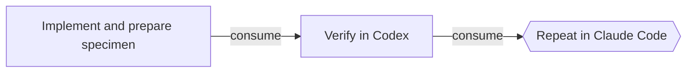

## Goal

Keep the editable HTML as the source, review individual elements in a live preview, and export a transparent PNG at 2×. Validate against one representative internal brand specimen and keep brand assets outside this repository.

## Graph

## Nodes

| id | mode | status | note |
|---|---|---|---|
| n1 | in_session | running | Version the skill and renderer together. Add routing from the authoritative modeling skill. |
| n2 | in_session | pending | Select an element, apply feedback in preview, and verify the change in the transparent 2× export. |
| n3 | parallel_hitl | pending | Repeat the same acceptance test with Launch preview in a separate session. |

## Log

| timestamp | node | session | event |
|---|---|---|---|
| 2026-11-25 | n1 | scope and execution design | Scope and graph approved. Implementation started. |
| 2026-11-25 | n1 | implementation | Added the standalone skill and renderer. The modeling skill exists in divergent installed copies. Its versioned source is still unidentified, so the routing change remains open. |
| 2026-11-25 | n2 | verification | Playwright confirmed a targeted content edit after reload and verified the transparent export at twice the capture dimensions. Interactive acceptance remains open because the desktop browser session could not initialize. |
