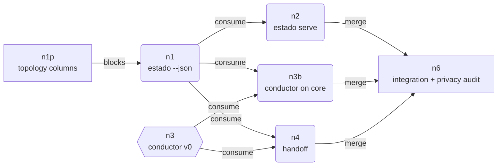

<!-- agent-generated:sesion runtime=claude-code branch=docs/estado-frontier-ronda-15 -->
---
id: estado-conductor-ejecucion
goal: "Build `secretary estado --json`, the local live HTML view, a minimal conductor skill and cross-harness handoff, as scoped in frontier-estado-visual-y-conductor"
status: active
created: 2026-11-10
updated: 2026-11-10
---

## Goal

Execute the scope confirmed in round 15 of [frontier-estado-visual-y-conductor-2026-11-10.md](frontier-estado-visual-y-conductor-2026-11-10.md). Evaluation: [estado-n0-evaluacion-herramientas-2026-11-10.md](estado-n0-evaluacion-herramientas-2026-11-10.md). Nothing merges without the owner's explicit OK. Metadata only: never read transcript content.

## Graph

`n1p blocks n1` applies only to the plan reader inside n1; the rest of n1 starts now.

## Nodes

| id | mode | status | note | session | harness | branch | pr |
|----|------|--------|------|---------|---------|--------|----|
| n1p | in_session | done | Add optional `session`, `harness`, `branch`, `pr` columns to the `topology` Nodes table (PLN-2b) | estado-n0 | claude-code | skills/topology-nodes-columns | 110 |
| n1 | autonomous | running | Core `secretary estado --json`: adapters (Claude desktop + CLI, Codex, Cursor degraded) with field whitelist, session→branch→path reconciler, plan reader, optional `--with-prs` (60 s cache), mtime polling, no new hooks, test that no field outside the whitelist is emitted | estado-n1-nucleo | claude-code | core/estado-json | |
| n2 | autonomous | pending | `secretary estado serve`: 127.0.0.1, read-only, `Host` header check, mtime polling. Depends on n1 | | | | |
| n3 | parallel_hitl | running | Skill `conductor` v0 on current sources; speaks on open, relation detected, close (CND-2). Owner reviews tone | estado-n3-conductor | claude-code | skills/conductor-v0 | |
| n3b | autonomous | pending | Conductor reads the n1 core instead of current sources (CND-5) | | | | |
| n4 | autonomous | pending | Handoff: 4 KB block, `.briefs`, paste-ready block per harness (SAL-1) | | | | |
| n6 | in_session | pending | Real run on the owner's machine, metadata-only audit, owner OK per PR | | | | |

Status values: `pending` | `running` | `done` | `blocked`

## Constraints

- Do not touch `~/.claude/settings.json` (existing hooks of 10 events).
- Claude desktop session files: read only the whitelist (`sessionId`, `cliSessionId`, `title`, `cwd`, `originCwd`, `createdAt`, `lastActivityAt`, `isArchived`, `model`, `scheduledTaskId`). Never the permission or MCP keys.
- Codex: only `id`, `cwd`, `git`, `timestamp` from `session_meta`; never `base_instructions`.
- Repo is public: English only, no private paths, names or emails.

## Log

| timestamp | node | session | event |
|-----------|------|---------|-------|
| 2026-11-10 | n1p | estado-n0 | running |
| 2026-11-10 | n1p | estado-n0 | done, PR 110 |
| 2026-11-10 | n1 | estado-n1-nucleo | started |
| 2026-11-10 | n3 | estado-n3-conductor | started |
