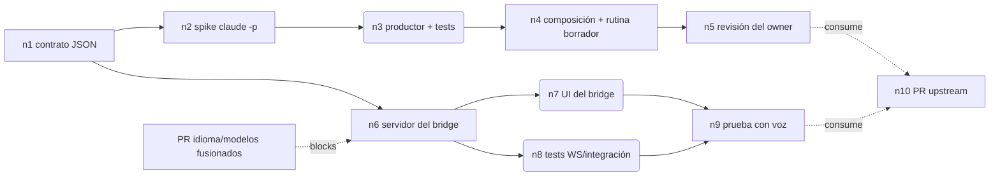

## Goal

Un productor externo (subcomando de `secretary` en este repo, híbrido: colección determinista + `claude -p` de solo lectura) escribe un JSON versionado de ítems tipados (tope ~400 tokens). El bridge (`rpavez/ai-voice-bridge`) lo lee solo si hay ruta configurada, muestra vista previa con casilla por ítem, Aprobar/Descartar, indicador de estado y botón Refresh (comando configurable), e inyecta el resumen aprobado al abrir la sesión de Gemini ("About the user (as of <date>)").

Fuera de alcance: palabras clave (plan aparte), resúmenes por sesión, avisos proactivos, relé, modo reflexivo.

Restricciones: el código del bridge (n6-n10) espera a que se fusionen los PR de idioma/modelos y parte de `main`. Nada se publica en `rpavez/ai-voice-bridge` sin confirmación explícita del owner. Datos personales (memoria, skills, prompts de secretary) nunca van al repo del bridge; este repo es el motor sin datos personales. Alcance confirmado en 4 rondas de Frontier (SCT-1..12, DEL-5/6, ACC-4, A1..A9).

## Graph

## Nodes

| id | mode | status | note |
|----|------|--------|------|
| n1 | in_session | done | Esquema, versión, ítems tipados, tope ~400 tokens. |
| n2 | in_session | done | Spike OK: `--tools Read,Glob,Grep` deja solo esas tres; `Bash(ls:*)` bloquea touch, `;`, `&&`, redirecciones y `tee` en modo -p. |
| n3 | autonomous | done | `secretary voice-context collect --out <path>`; commit 338456b en rama core/voice-bridge-context (local, sin push); 18 tests pasan; prueba real: 14 ítems (5 commitment, 5 brief, 4 session), 1596 chars. |
| n4 | in_session | done | `secretary voice-context compose` (claude -p sin herramientas, fallback determinista); borrador de rutina en docs/voice-bridge-routine-draft.md (sin instalar); commit ad799ab en core/voice-bridge-context. |
| n5 | in_session | done | Revisión del owner: ver docs/plans/voice-bridge-scout-n5-review.md; decisiones aplicadas en core/voice-bridge-context. |
| n6 | in_session | done | Servidor: `context-summary.js` + cableado en `server.js` (mensajes `context_*`, nota en el prompt de Gemini); 17 tests unitarios. Rama `context/summary` apilada sobre `settings-language-models` (PR #2), commit local, sin push. |
| n7 | autonomous | done | UI: vista previa, casillas, Aprobar/Descartar, indicador, Refresh. |
| n8 | autonomous | done | Tests WebSocket: lectura, tope, exclusión, aprobación, estados. |
| n9 | in_session | pending | Prueba del owner con voz y vista. |
| n10 | in_session | pending | PR upstream: tras unos días de uso y con confirmación explícita. |

## Log

| timestamp | node | session | event |
|-----------|------|---------|-------|
| 2026-11-19 | n1 | scout | plan created; n1 started |
| 2026-11-19 | n1 | scout | contract v1 approved by owner |
| 2026-11-19 | n2 | scout | spike done: closed read-only tool list works with claude 2.1.303 (--tools, --allowedTools, --setting-sources "", --strict-mcp-config, --no-session-persistence, --max-turns, --max-budget-usd); Bash prefix allowlist denies chaining and redirects. Cost ~0.002 USD per run with haiku |
| 2026-11-19 | n3 | scout | launched as session scout-n3-producer (local_66d344ac-34ca-445d-843b-30b2013deae3), worktree cut from docs/voice-bridge-scout-plan |
| 2026-11-19 | n3 | scout | done and verified (tests rerun, fixtures without personal data); n4 next |
| 2026-11-19 | n4 | scout | done: compose with `--tools ""` (stricter than planned Read/Glob/Grep; candidates travel in the prompt); 26 tests; real run 6 s, 13 items, ~1000 chars; waiting n5 review |
| 2026-11-19 | n5 | scout | done: owner confirmed SES-1/2, CMP-1, BRF-1, ORD-1; applied; real run 11 items, 947 chars |
| 2026-11-19 | n6 | scout | owner OK: DEL-6 changed from "start from main" to "stack on settings-language-models (PR #2 open)"; retarget to main when #2 merges |
| 2026-11-19 | n6 | scout | done: server side, branch context/summary in worktree .wt/context-summary; sounds moved by owner request to ui/sound-cues (2 commits), also stacked on PR #2 |
| 2026-11-19 | n7,n8 | scout | launched in parallel: scout-n7-ui (local_eb883493-61d1-4b86-8180-8c71e229fb44, branch context-summary-ui) and scout-n8-tests (local_aea2b002-9d7c-4c27-9671-285401b96399, branch context-summary-tests), both cut from context/summary |
| 2026-11-19 | n7,n8 | scout | done: n7 commit 1453463 (UI, verified with stubbed Gemini), n8 commit dbc31f3 (54/54 twice); owner OK to merge: both merged locally into context/summary (61a09ee), no push. Finding: upstream syncTimer TDZ in teardown (in origin/main). n9 next |
| 2026-11-23 | n7,n8 | conductor | plan pushed for the first time (the branch with commit 75888b4 stayed local); n7 and n8 confirmed done, n9 still open |

## Follow-ups

- **syncTimer (pending):** while testing the `context-summary.js` work, n8 found a temporal-dead-zone error: `syncTimer` is used in session teardown before it is declared. The n8 log places it in the bridge's upstream `origin/main`, not in the new code. Needs a follow-up fix (and an upstream report) before n9 relies on clean teardown.
- **PR #116 (merged before review):** the opt-in `repo` source for `secretary voice-context` (PR H) was merged on 2026-11-20 without owner review. It stays in `main` unless the owner asks for a revert; default sources are unchanged, so it only applies with `--sources ...,repo`.
