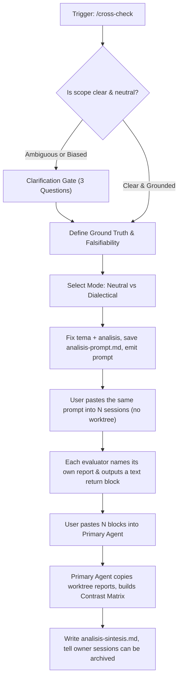

# cross-check

Spin up independent, blind evaluations across parallel agent sessions (different models, different harnesses, or fresh clean contexts). Use this skill when active reasoning suffers from confirmation bias, context rot, or premature hypothesis lock-in.

The skill produces three coordinated deliverables:
1. **A Decoupled Evaluator Prompt:** Strips prior conjectures and anchors to feed external agents only raw, verifiable facts.
2. **An Isolated Persistence Target:** Each evaluator names its own report `.analysis/<tema>/<analisis>-<harness>-<full-model-id>.md` in the main checkout, so parallel runs never share a file. The human pastes the same prompt everywhere and edits nothing.
3. **A Stackable Return Block:** One plain-text block emitted by each evaluator that the user can copy and paste consecutively into the primary agent session for automated comparative synthesis.

---

## Workflow



---

## 1. Clarification Gate

Before composing the external evaluation prompt, verify whether the problem definition is objective and factual.

If the prompt from the current session contains speculative conclusions (e.g., *"Investigate why the database timed out because of connection pool starvation"*), **halt and request clarification on these three fields**:

1. **Neutral Question / Decision:** The core question without pre-baked answers (e.g., *"What is the root cause of timeout spikes in module X under sustained load?"*).
2. **Observable Raw Sources:** Concrete file paths, commit hashes, metrics tables, or raw logs (`file:///...`).
3. **Falsifiability Criterion:** What empirical finding or counter-example would definitively invalidate the prevailing hypothesis?

---

## 2. Blind Framing Rules

To preserve epistemic independence across evaluators:

- **Zero Conjecture Leakage:** Never include the primary agent's working theories, intermediate debates, or emotional tone.
- **Direct Pointers:** Pass absolute or workspace-relative links to raw source files so evaluators read ground truth instead of paraphrased snippets.
- **Isolated File Namespace:** The primary session fixes two values inside the prompt: `<tema>` (the folder, e.g. `soltrak-senales-vs-modelo`) and `<analisis>` (the analysis name, e.g. `horas`). Each evaluator writes `.analysis/<tema>/<analisis>-<harness>-<full-model-id>.md`, e.g. `horas-claude-code-claude-opus-5-5.md` or `horas-codex-gpt-5-codex.md`. The model part is the full model id, never the family name alone (`claude` or `gpt` is not enough: two Claude models in the same panel would collide). Add `.analysis/` to `.gitignore` if not already ignored.
- **No Placeholders for the Human:** The emitted prompt contains no ID slot and no instruction to edit it. The human pastes the same block into every session. The evaluator derives its own file name from its harness and model.
- **No Overwrite:** If the target file already exists, the evaluator does not overwrite it. It appends `-2` (then `-3`, and so on) before `.md` and states in its return block which name it used.
- **Main Checkout, Absolute Paths:** The evaluator resolves the main checkout with `git rev-parse --path-format=absolute --git-common-dir` (the parent of that directory is the main checkout root) and writes with absolute paths. A relative `.analysis/` path inside a harness worktree lands in that worktree and is lost when the session is archived.
- **No Harness Worktree:** Evaluator sessions are read-only. Launch them without a harness worktree; the first line of the prompt says so. If the harness still runs the session inside a worktree and blocks writing to the main checkout, the evaluator writes the report inside its worktree at `.analysis/<tema>/`, puts that absolute path in the return block, and does not bypass the guard via shell. The primary session rescues the file (see section 5).

---

## 3. Evaluation Modes

Offer two operational modes depending on the nature of the inquiry:

### Mode 1: Neutral Blind (Default)
The exact same neutral prompt is dispatched across N fresh sessions. Best for unbiased consensus and anomaly detection.

### Mode 2: Dialectical Tension (Contrast Roles)
Generates role-differentiated prompts to stress-test critical decisions from divergent angles:
- **Role A (Evidence Auditor):** Rigorously checks whether numbers, telemetry, and source code actually support the claims.
- **Role B (Devil's Advocate / Skeptic):** Actively searches for edge cases, race conditions, architecture anti-patterns, and reasons why the proposed solution will fail.
- **Role C (Pragmatic Juror / Minimalist):** Searches for simpler alternative explanations (Occam's razor) and assesses operational blast radius.

---

## 4. Evaluator Prompt Template

Before emitting, the primary session replaces `[TEMA]`, `[ANALISIS]`, and the other bracketed fields with concrete values. It then saves the final prompt to `<main-checkout>/.analysis/<tema>/<analisis>-prompt.md` (absolute path) and emits it in one copy-ready block. The prompt keeps `<harness>` and `<full-model-id>` as words the evaluator resolves itself; they are not slots for the human.

````text
Run this session read-only and without a harness worktree.

You are an independent evaluator on a blind cross-check panel. Your mandate is to analyze the situation below from scratch, free of prior assumptions or session bias.

### Objective
[NEUTRAL_DECISION_OR_DIAGNOSIS_TARGET]

### Data Sources
Inspect these files and data points directly:
- [RAW_FILE_OR_LOG_PATH_1]
- [RAW_FILE_OR_LOG_PATH_2]

### Guardrails
- Rely only on verifiable facts from the provided sources. Do not extrapolate without labeling assumptions.
- Explicitly state what evidence would disprove your findings.
- Falsifiability standard: [FALSIFIABILITY_CRITERION].

### Deliverable Instructions
1. Name your report yourself. Do not ask the human for an ID.
   - harness: the agent product running you, lowercase with hyphens (e.g. claude-code, codex, cursor).
   - full-model-id: your exact model id, lowercase, dots and spaces as hyphens (e.g. claude-opus-5-5). Never the family name alone.
   - File name: [ANALISIS]-<harness>-<full-model-id>.md

2. Resolve the main checkout: run `git rev-parse --path-format=absolute --git-common-dir` and take its parent directory. Write your full, exhaustive technical analysis to the absolute path:
   <main-checkout>/.analysis/[TEMA]/[ANALISIS]-<harness>-<full-model-id>.md
   Create the folder if it does not exist. If the file already exists, do not overwrite it: append -2 (then -3, and so on) before .md and say which name you used.

3. If your harness runs you inside a worktree and blocks writing to the main checkout, write the same file inside your worktree at .analysis/[TEMA]/ instead. Do not bypass the guard via shell. Report the absolute path you actually used.

4. End your reply with exactly ONE fenced block tagged text, as the last element of the reply. No markdown inside it, no nested fences, nothing after it. Fill it like this:

CROSS-CHECK RESULT
Evaluator: <harness> / <full-model-id>
Directive for receiving agent: ingest this evaluation into the contrast matrix. If several result blocks appear in one message, process all of them before replying.

Verdict: <direct conclusion in 1-2 sentences>
Key evidence:
- <critical file path, line number, or data point>
- <...>
Blind spots and discrepancies:
- <factor that contradicts the obvious view, or unaddressed risk>
- <...>
Confidence: <High | Medium | Low> - <brief justification>
Full report: <absolute path of the file you wrote>
Report location: <main checkout | harness worktree>
````

The return block carries the full summary (verdict, key evidence, blind spots) so the primary session can synthesize even if a report file is missing. It is plain text inside a single fence: when the human copies the reply, the block arrives intact and no rendered markdown or earlier commentary comes with it.

---

## 5. Primary Agent Synthesis Protocol

When the user returns to the primary session and pastes one or more `CROSS-CHECK RESULT` blocks consecutively, the primary agent must adhere to this ingest protocol:

0. **Rescue Reports First:** For each block whose report location is a harness worktree, copy that file into `<main-checkout>/.analysis/<tema>/` with the same name (apply the `-2` rule on collision). Verify every report listed in the blocks exists in the main checkout before going on.
1. **Defer Immediate Judgment:** Do not dismiss dissenting opinions or prematurely declare victory for the initial hypothesis.
2. **Render a Native Markdown Contrast Matrix:**

| Dimension | Initial Hypothesis | Evaluator 1 | Evaluator 2 | Consensus vs Dissent |
|---|---|---|---|---|
| Root Cause / Decision | ... | ... | ... | ... |
| Primary Evidence | ... | ... | ... | ... |
| Overlooked Risks / Gaps | ... | ... | ... | ... |

3. **Expose Blind Spots:** Answer explicitly:
   - What did the independent evaluators discover that was completely missed or discounted in this session?
   - Where do all evaluators agree unanimously?
   - What fundamental disagreements remain, and what single empirical test or probe would resolve them?
4. **Actionable Resolution:** Formulate the final conclusion or next step anchored in the triangulated evidence.
5. **Persist and Release:** Write the matrix, blind spots, and resolution to `<main-checkout>/.analysis/<tema>/<analisis>-sintesis.md` (absolute path). Then tell the owner the evaluator sessions can be archived. Say so only after step 0 is done: archiving a session that still holds a report in its worktree discards that report.
